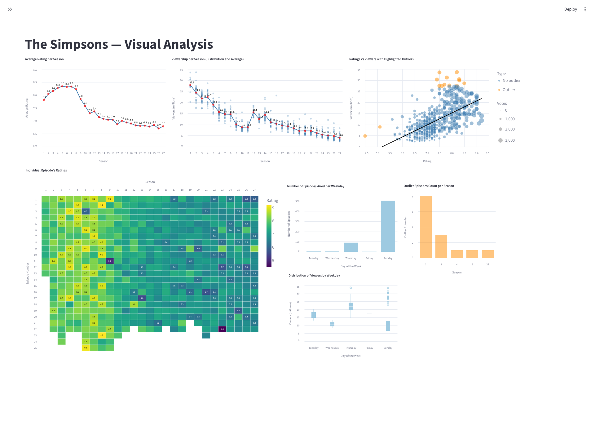
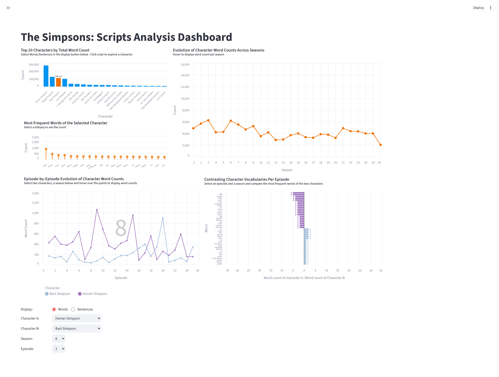

# The Simpsons: Visual Analysis (Altair + Streamlit)

Two interactive dashboards that explore 27 seasons of *The Simpsons* (1989–2016): how ratings and viewership
evolved, and what the main characters actually say. Built for the Data Visualization course of the MSc in Data
Science at UPC (FIB), 2025–2026.

**Stack:** Python · pandas · Vega-Altair · Streamlit · OpenRefine (data cleaning)

## Dashboard 1: Ratings and viewership



Six coordinated views over 596 episodes:

- Average IMDb rating and viewership per season, with every episode shown behind the average.
- Ratings vs. viewers scatter (point size = votes) with a regression line and IQR-based outliers highlighted.
- A season × episode heatmap of ratings, with labels only on the best (≥ 8.5) and worst (≤ 6.5) episodes.
- Episodes per weekday plus the viewer distribution per weekday (boxplot).
- Number of outlier episodes per season.

**What the data shows**

- Ratings peak in **season 5** (average 8.34), then fall steadily to about 6.8 for the last seasons.
- Viewership falls from 27.8M per episode in season 1 to 4.0M in season 27, with a rebound in season 12.
- Rating and viewers are positively correlated (r = 0.62).
- The best-rated episode is *You Only Move Twice* (S8E2, 9.2); the worst is *Lisa Goes Gaga* (S23E22, 4.5).
- 502 of the 596 episodes aired on a Sunday. Viewer outliers (12 episodes) are almost all from the first seasons.

## Dashboard 2: What the characters say



Built from ~132k script lines of the 20 most talkative characters:

- Top-20 characters by words or by sentences (radio toggle). Click a bar to select a character.
- Lollipop chart with that character's most frequent words or sentences, and their word count per season.
- Episode-by-episode word count of two characters in a chosen season.
- Diverging bars comparing the vocabulary of two characters in a single episode (stopwords removed).

All views are linked through Altair parameters and selections, so the interaction runs in the browser
without a Python round-trip.

## Data

Both dashboards use two files from the Kaggle dataset
[The Simpsons Dataset](https://www.kaggle.com/datasets/prashant111/the-simpsons-dataset) by Prashant Banerjee:
the episode metadata (`simpsons_episodes.csv`) and the script lines (`simpsons_script_lines.csv`). See
[`data/README.md`](data/README.md) for what is and is not included in this repository.

### Cleaning (OpenRefine)

The raw episode file (600 rows, 14 columns) was cleaned with OpenRefine into `simpsons-episodes-clean.csv`
(596 rows, 8 columns). Main steps: dropped season 28 (incomplete), imputed 3 missing viewer counts,
removed and renamed columns, and derived a `Weekday` column from the air date with GREL. The full list of
steps, and the reasoning behind every chart (marks, encodings, colour scales), is in
`notebooks/assignment_1_report.ipynb`.

## Project structure

```
.streamlit/  Streamlit configuration (light theme)
data/        cleaned episode data (script lines not included, see data/README.md)
images/      dashboard screenshots
notebooks/   assignment 1 report: cleaning steps and design rationale
src/         ratings_dashboard.py, scripts_dashboard.py (Streamlit apps)
```

## Run it locally

```bash
python -m venv .venv && source .venv/bin/activate   # Windows: .venv\Scripts\activate
pip install -r requirements.txt

streamlit run src/ratings_dashboard.py
```

The scripts dashboard also needs `data/simpsons-script-lines-clean.csv` (see `data/README.md`):

```bash
streamlit run src/scripts_dashboard.py
```

On first load it takes a few seconds to aggregate the dialogue; results are cached afterwards.

Run the commands from the repository root so Streamlit picks up `.streamlit/config.toml`. It forces the
light theme, which the charts are designed for.

## Notes

- The notebook's chart outputs are interactive Vega HTML, which GitHub does not render. Open it locally
  in Jupyter or VS Code to see the charts.
- The assignment 2 notebook is not included: its embedded chart data makes it 130+ MB, above GitHub's
  100 MB file limit. The scripts dashboard in `src/` contains the same code.

## Author

Lluís Mompó Ruiz · [GitHub](https://github.com/lluismomporuiz)